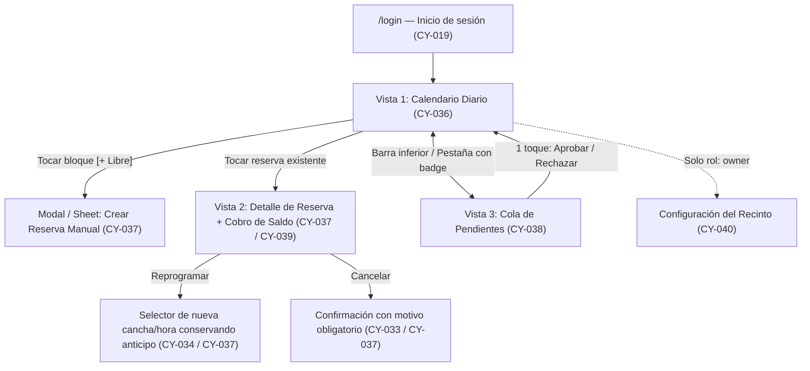

# Wireframes del Panel Operativo — CanchaYa (CY-035)

**Ticket:** `CY-035` · **Épica:** E2 (Núcleo de reservas y panel) · **Rol:** UX/UI  
**Requisitos cubiertos:** `RF-05`, `RF-08`, `RF-09`, `RF-12`, `RF-14`, `RF-15`, `RF-16`, `RNF-05`, `RNF-09`

---

## 1. Contexto operativo y principios de diseño

El panel de CanchaYa está diseñado para el recinto piloto en **Pamplona, Colombia** (`CanchaYa Piloto Pamplona`, horario `14:00` a `24:00` en `America/Bogota`, bloques de `60 min`, tarifa base `$60.000 COP` enteros y anticipo del `20%` = `$12.000 COP`).

### Principios clave (`RNF-05`)

1. **Mobile-first real para el turno nocturno:** El empleado opera principalmente desde su celular mientras atiende la recepción, entrega balones/raquetas y recibe pagos en efectivo o transferencia entre las 6:00 p.m. y las 11:00 p.m.
2. **Regla de un toque en tareas frecuentes:**
   - Ver qué cancha está libre hoy a una hora determinada: **1 toque**.
   - Aprobar o rechazar un comprobante de anticipo: **1 toque** desde la cola de pendientes.
   - Registrar el saldo (`$48.000 COP`) en efectivo o transferencia y marcar como jugada (`COMPLETED`): **2 toques**.
3. **Cero ambigüedad monetaria y horaria:**
   - Todos los montos se muestran en **pesos colombianos enteros** (`$60.000`, `$12.000`, `$48.000`), sin decimales.
   - Todas las horas se muestran en **`America/Bogota`** (formato 12h amigable `6:00 p.m.` junto con etiqueta 24h `18:00` cuando aporta claridad), aunque en base de datos se almacenen en `UTC` (`RNF-09`).
4. **Diferenciación por rol (`RF-16`):**
   - `staff` (Empleado): ve **Calendario**, **Pendientes** (comprobantes + chats con humano) y **Nueva reserva**.
   - `owner` (Dueño): ve todo lo del empleado más **Configuración** (`CY-040`) y, en fases posteriores, **Caja y Reportes** (`CY-090`, `CY-093`).

---

## 2. Arquitectura de navegación y código visual de estados



### Semáforo de estados en el calendario (`RF-14`, `CY-033`)

| Estado en BD (`BookingStatus`)           | Etiqueta en UI         | Indicador visual / Color semántico                        | Qué muestra la celda                                      | ¿Bloquea cancha?        |
| :--------------------------------------- | :--------------------- | :-------------------------------------------------------- | :-------------------------------------------------------- | :---------------------- |
| _(Sin reserva activa)_                   | **Libre**              | Fondo neutro con borde punteado `+ Libre`                 | Acción rápida `+ Reservar ($60.000)`                      | No                      |
| `HOLD` _(sin comprobante aún)_           | **Separada (HOLD)**    | Ámbar / Amarillo (`⏳ 11:40 min`)                         | Nombre cliente + cuenta regresiva hasta `hold_expires_at` | Sí (15 min)             |
| `HOLD` _(con pago `pending_validation`)_ | **Por validar**        | Azul / Violeta pulsante (`🧾 Validar anticipo`)           | Nombre cliente + aviso de comprobante recibido            | Sí (protegida del cron) |
| `CONFIRMED`                              | **Confirmada**         | Verde esmeralda (`✓ Anticipo $12.000`)                    | Nombre cliente + `Saldo: $48.000`                         | Sí                      |
| `COMPLETED`                              | **Jugada**             | Gris verdoso oscuro (`✓✓ Pagada $60.000`)                 | Nombre cliente + método de pago del saldo                 | Sí (histórico)          |
| `NO_SHOW`                                | **No asistió**         | Rojo suave / ladrillo (`✕ No-show`)                       | Nombre cliente + anticipo retenido                        | Sí (histórico)          |
| `CANCELLED` / `RESCHEDULED`              | **Cancelada / Movida** | No ocupa la celda principal (visible en historial/filtro) | La celda vuelve a mostrarse **Libre**                     | No                      |

---

## 3. Wireframe 1 — Calendario Diario (`CY-036`, `RF-14`)

### 3.1 Vista Celular (Mobile-first, 360px–430px)

En pantallas móviles, mostrar 4 columnas simultáneas reduce el ancho de cada tarjeta a menos de 80px y dificulta la lectura nocturna. Por ello, en móvil se usa **selector rápido por deporte/cancha con pestañas superiores** (mostrando 2 canchas a la vez por deporte: _Pádel 1 y 2_ o _Fútbol 5 - 1 y 2_, o 1 cancha expandida con deslizamiento horizontal).

```text
+-------------------------------------------------------------------+
| 🏟️ CanchaYa Pamplona                      [🔔 Pendientes (3)] [👤] |
+-------------------------------------------------------------------+
| [◀]  📅 Martes, 10 Nov 2026 (Hoy)  [▶]              [Ir a Hoy]    |
+-------------------------------------------------------------------+
| Deporte: (•) 🎾 Pádel (2)    ( ) ⚽ Fútbol 5 (2)    ( ) Todas (4) |
+-------------------------------------------------------------------+
| Hora  | Cancha Pádel 1             | Cancha Pádel 2               |
|-------|----------------------------|------------------------------|
| 14:00 | [ + Libre · $60.000 ]      | [ + Libre · $60.000 ]        |
|-------|----------------------------|------------------------------|
| 15:00 | [ + Libre · $60.000 ]      | [✓ CONFIRMADA]               |
|       |                            | Carlos Gómez                 |
|       |                            | Saldo: $48.000               |
|-------|----------------------------|------------------------------|
| 16:00 | [✓✓ JUGADA]                | [✕ NO-SHOW]                  |
|       | Andrés Vera                | Equipo Norte                 |
|       | Pagado: $60.000 (Efectivo) | Anticipo: $12.000            |
|-------|----------------------------|------------------------------|
| ...   | ...                        | ...                          |
|-------|----------------------------|------------------------------|
| 19:00 | [🧾 POR VALIDAR]           | [✓ CONFIRMADA]               |
|       | Mateo Rojas                | Laura Méndez                 |
|       | Comprobante $12.000 reçu   | Saldo: $48.000               |
|-------|----------------------------|------------------------------|
| 20:00 | [⏳ HOLD · 09:15 min]      | [✓ CONFIRMADA]               |
|       | Camilo Duarte              | Diego Parra                  |
|       | Esperando anticipo $12.000 | Saldo: $48.000               |
|-------|----------------------------|------------------------------|
| 21:00 | [ + Libre · $60.000 ]      | [ + Libre · $60.000 ]        |
|-------|----------------------------|------------------------------|
| 22:00 | [✓ CONFIRMADA]             | [ + Libre · $60.000 ]        |
|       | Juan Sebastián             |                              |
|       | Saldo: $48.000             |                              |
|-------|----------------------------|------------------------------|
| 23:00 | [ + Libre · $60.000 ]      | [ + Libre · $60.000 ]        |
+-------------------------------------------------------------------+
|  [📅 Calendario]     [🧾 Pendientes (3)]     [➕ Nueva Reserva]   |
+-------------------------------------------------------------------+
```

### 3.2 Vista Escritorio / Tablet Horizontal (≥ 1024px)

En escritorio o tablet en recepción, se muestran las **4 canchas en paralelo** (`Cancha Pádel 1`, `Cancha Pádel 2`, `Cancha Fútbol 5 - 1`, `Cancha Fútbol 5 - 2`) junto con una columna derecha fija para la cola de pendientes.

```text
+--------------------------------------------------------------------------------------------------------------------+
| 🏟️ CanchaYa — Piloto Pamplona   |  [◀] Martes 10 Nov 2026 [▶] [Hoy]  |  Filtro: [Todos]  |  Rol: Empleado  [Salir] |
+--------------------------------------------------------------------------------------------------------------------+
| Hora  | 🎾 Cancha Pádel 1   | 🎾 Cancha Pádel 2   | ⚽ Fútbol 5 - 1      | ⚽ Fútbol 5 - 2      | 🧾 PENDIENTES (3)  |
|-------|---------------------|---------------------|---------------------|---------------------|--------------------|
| 18:00 | [✓✓ JUGADA]         | [ + Libre ]         | [✓✓ JUGADA]         | [✓✓ JUGADA]         | 1. Anticipo $12.000|
|       | A. Vera · $60.000   |   + Reservar        | Club Pamplona       | Los Amigos          | Mateo Rojas        |
|-------|---------------------|---------------------|---------------------|---------------------| Pádel 1 · 19:00    |
| 19:00 | [🧾 POR VALIDAR]    | [✓ CONFIRMADA]      | [✓ CONFIRMADA]      | [ + Libre ]         | [Ver comprobante]  |
|       | Mateo Rojas         | Laura Méndez        | Jorge Silva         |   + Reservar        | [✓ Aprobar] [✕]    |
|       | Anticipo en rev.    | Saldo: $48.000      | Saldo: $48.000      |                     |--------------------|
|-------|---------------------|---------------------|---------------------|---------------------| 2. Anticipo $12.000|
| 20:00 | [⏳ HOLD 09:15]     | [✓ CONFIRMADA]      | [✓ CONFIRMADA]      | [✓ CONFIRMADA]      | Sofía León         |
|       | Camilo Duarte       | Diego Parra         | Selección U         | Atlético Norte      | Fútbol 5-2 · 22:00 |
|       | Falta anticipo      | Saldo: $48.000      | Saldo: $48.000      | Saldo: $48.000      | [Ver comprobante]  |
|-------|---------------------|---------------------|---------------------|---------------------| [✓ Aprobar] [✕]    |
| 21:00 | [ + Libre ]         | [ + Libre ]         | [⏳ HOLD 13:40]     | [ + Libre ]         |--------------------|
|       |   + Reservar        |   + Reservar        | Felipe Mora         |   + Reservar        | 3. 💬 Chat Humano  |
|-------|---------------------|---------------------|---------------------|---------------------| Cliente pregunta   |
| 22:00 | [✓ CONFIRMADA]      | [ + Libre ]         | [ + Libre ]         | [🧾 POR VALIDAR]    | por torneo viernes |
|       | Juan Sebastián      |   + Reservar        |   + Reservar        | Sofía León          | [Abrir WhatsApp]   |
|-------|---------------------|---------------------|---------------------|---------------------|                    |
| 23:00 | [ + Libre ]         | [ + Libre ]         | [ + Libre ]         | [ + Libre ]         | [➕ Nueva Reserva] |
+--------------------------------------------------------------------------------------------------------------------+
```

---

## 4. Wireframe 2 — Detalle de Reserva, Cobro de Saldo y Acciones Manuales (`CY-037`, `CY-039`)

Al tocar cualquier reserva del calendario, se despliega una **Hoja Inferior (_Bottom Sheet_)** en celular o un **Panel Lateral Derecho (_Drawer_)** en escritorio, sin perder el contexto del día.

### 4.1 Detalle de reserva `CONFIRMED` + Registro del saldo (`CY-039`, `RF-09`)

```text
+-------------------------------------------------------------------+
| ━━━ (deslizar para cerrar)                              [✕ Cerrar]|
| [✓ CONFIRMADA]                           Reserva #CY-8F3A         |
| 🎾 Cancha Pádel 2 · Hoy, Mar 10 Nov · 20:00 – 21:00 (60 min)      |
+-------------------------------------------------------------------+
| 👤 Cliente:  Diego Parra                                          |
| 📱 Teléfono: +57 315 XXX XXXX             [💬 Abrir en WhatsApp]  |
| 📝 Notas:    Alquila 2 raquetas (nota informativa)                |
+-------------------------------------------------------------------+
| 💰 RESUMEN DE PAGO (COP enteros)                                  |
| • Valor total cancha (60 min):                   $60.000 COP      |
| • Anticipo (20% · Transferencia aprobada):      -$12.000 COP ✓    |
| ----------------------------------------------------------------- |
| • SALDO PENDIENTE EN RECINTO:                    $48.000 COP      |
+-------------------------------------------------------------------+
| 💵 REGISTRAR PAGO DEL SALDO Y MARCAR JUGADA (RF-09)               |
| Método de pago del saldo ($48.000 COP):                           |
|  (•) Efectivo ($48.000)   ( ) Transferencia ($48.000)   ( ) Mixto |
|                                                                   |
| [Si elige "Mixto", se muestran dos campos enteros que suman 48000]|
|   Efectivo COP:      [ $20.000 ]                                  |
|   Transferencia COP: [ $28.000 ]   (Suma: $48.000 / $48.000 ✓)    |
|                                                                   |
| [ ✅ REGISTRAR SALDO ($48.000) Y MARCAR JUGADA (COMPLETED) ]      |
+-------------------------------------------------------------------+
| OTRAS ACCIONES OPERATIVAS (RF-15, CY-034, CY-037)                 |
| [ 🔄 Reprogramar / Mover ]   [ 🚫 Marcar No-Show ]   [ ✕ Cancelar ]|
+-------------------------------------------------------------------+
```

> **Regla de negocio integrada (`validatePaymentBreakdownCop` en `packages/core`):**
>
> - Si el método es `cash`, `cash_amount_cop = 48000` y `transfer_amount_cop = 0`.
> - Si el método es `transfer`, `transfer_amount_cop = 48000` y `cash_amount_cop = 0`.
> - Si el método es `mixed`, ambos campos deben ser enteros positivos y sumar exactamente `balance_due_cop` (`$48.000 COP`). El botón principal se deshabilita si la suma no coincide.
> - Los botones **Marcar Jugada (`COMPLETED`)** y **Marcar `NO_SHOW`** validan la máquina de estados (`booking-state-machine.ts`) cuando el turno se atiende o finaliza.

### 4.2 Flujo para Crear Reserva Manual (`CY-037`, `RF-15`)

Cuando un cliente llama por teléfono o llega directamente al recinto, el empleado toca una celda `[ + Libre ]` y se precargan cancha, fecha y hora:

```text
+-------------------------------------------------------------------+
| ➕ NUEVA RESERVA MANUAL                                 [✕ Cerrar]|
+-------------------------------------------------------------------+
| 🎾 Cancha: [ Cancha Pádel 1 ▼ ]                                   |
| 📅 Fecha:  [ 2026-11-10     ]   ⏰ Hora: [ 21:00 – 22:00 (60m) ▼ ]|
+-------------------------------------------------------------------+
| 👤 Teléfono WhatsApp: [ +57 310 000 0000 ] (busca si ya existe)   |
| 👤 Nombre del cliente:[ Camilo Rincón    ]                        |
| 📝 Notas (opcional):  [ Reserva telefónica ]                      |
+-------------------------------------------------------------------+
| 💰 Tarifa: $60.000 COP · Anticipo requerido (20%): $12.000 COP    |
|                                                                   |
| Estado inicial de la reserva:                                     |
| (•) ⏳ Crear en HOLD (15 min para que envíe el anticipo)          |
| ( ) ✓ Confirmar de una vez (ya pagó anticipo $12.000 en sitio/Ya) |
|     └─ Método anticipo: (•) Transferencia  ( ) Efectivo           |
|                                                                   |
| [ 💾 GUARDAR RESERVA ]                                            |
+-------------------------------------------------------------------+
```

### 4.3 Flujo para Mover / Reprogramar (`CY-034`, `CY-037`, `RF-05`)

Al tocar `[ 🔄 Reprogramar / Mover ]` desde el detalle:

1. Muestra un banner con la política del recinto: _"Política: mínimo 4 horas de antelación (`min_reschedule_hours = 4`). El anticipo de `$12.000 COP` se conserva automáticamente en la nueva hora."_
2. Si faltan menos de 4 horas para `starts_at`, advierte que no cumple la ventana estándar de autogestión (`INSUFFICIENT_NOTICE`).
3. Permite elegir **Nueva fecha**, **Nueva cancha** y **Nueva hora libre** (consultando `getAvailableSlots` / `rescheduleBooking` de `packages/core`).
4. Al confirmar, la reserva original pasa a `RESCHEDULED` (liberando la cancha original) y la nueva reserva queda en `CONFIRMED` con `rescheduled_from_booking_id` y el anticipo de `$12.000 COP` preservado.

---

## 5. Wireframe 3 — Cola de Pendientes (`CY-038`, `RF-08`, `RF-12`)

Accesible desde la pestaña inferior `[🧾 Pendientes (3)]` en celular o la columna derecha en escritorio. Agrupa todo lo que requiere acción del empleado para que ninguna reserva nocturna se pierda.

```text
+-------------------------------------------------------------------+
| 🧾 COLA DE PENDIENTES (3)                        [Actualizar ↻]   |
+-------------------------------------------------------------------+
| [ (•) Comprobantes por validar (2) ]   [ ( ) Chats humanos (1) ]  |
+-------------------------------------------------------------------+
| TARJETA 1 · Recibido hace 2 min · Reserva protegida de expirar    |
| ----------------------------------------------------------------- |
| 👤 Mateo Rojas · 📱 +57 311 XXX XXXX                              |
| 🎾 Cancha Pádel 1 · Hoy Mar 10 Nov · 19:00 – 20:00                |
| 💰 Anticipo esperado (20%): $12.000 COP  (Total: $60.000 COP)     |
|                                                                   |
| +---------------------------------------------------------------+ |
| | [🖼️ Vista previa del comprobante Nequi / Bancolombia]         | |
| |   Valor en imagen · Fecha · Referencia                        | |
| |                                      [🔍 Tocar para ampliar]  | |
| +---------------------------------------------------------------+ |
|                                                                   |
|   [ ✅ APROBAR ($12.000) ]           [ ✕ RECHAZAR ]               |
+-------------------------------------------------------------------+
| TARJETA 2 · Recibido hace 5 min                                   |
| ----------------------------------------------------------------- |
| 👤 Sofía León · 📱 +57 320 XXX XXXX                               |
| ⚽ Cancha Fútbol 5 - 2 · Hoy Mar 10 Nov · 22:00 – 23:00           |
| 💰 Anticipo esperado (20%): $12.000 COP  (Total: $60.000 COP)     |
| [🖼️ Vista previa del comprobante]      [🔍 Tocar para ampliar]    |
|                                                                   |
|   [ ✅ APROBAR ($12.000) ]           [ ✕ RECHAZAR ]               |
+-------------------------------------------------------------------+
```

### Comportamiento de un toque en la cola (`CY-038`, `CY-057`)

- **Al tocar `[ ✅ APROBAR ($12.000) ]`:**
  1. Actualiza el pago a `status = 'approved'`, registra `validated_by_user_id` y `validated_at`.
  2. Transiciona la reserva de `HOLD` a `CONFIRMED` y ajusta `balance_due_cop = 48000`.
  3. Dispara la notificación de confirmación por WhatsApp al cliente (`CY-057`).
  4. Retira la tarjeta de la cola con una confirmación breve (_"Reserva confirmada — Mateo Rojas 19:00"_).
- **Al tocar `[ ✕ RECHAZAR ]`:**
  1. Muestra 3 chips de motivo rápido (`rejection_reason` obligatorio en BD): `[Monto incompleto]`, `[Imagen borrosa / no abre]`, `[Comprobante no válido]` + campo libre opcional.
  2. Al confirmar el motivo, marca el pago en `status = 'rejected'` y notifica al cliente por WhatsApp para que envíe el comprobante correcto o libera la hora si el `HOLD` ya venció.

### Pestaña "Chats humanos" (`CY-059`, `RF-12`)

Cuando el bot transfiere una conversación a humano, aparece una tarjeta con:

- Nombre/teléfono del cliente y último mensaje recibido.
- Botón `[ 💬 Responder en WhatsApp ]` y botón `[ 🤖 Devolver control al bot ]` cuando el empleado termina de atenderlo.

---

## 6. Revisión con el empleado y validación de usabilidad (`RNF-05`)

Para asegurar que el panel se aprenda a usar en **menos de 30 minutos** (`RNF-05`) y responda al flujo nocturno real del recinto en Pamplona, se define el protocolo de revisión de estos wireframes con el empleado:

### 6.1 Las 5 tareas de prueba (recorrido guiado de 15 minutos)

| #      | Escenario operativo real                                                                                                        | Pantalla / Wireframe                  | Meta de tiempo / toques | Criterio de aprobación del empleado                                                   |
| :----- | :------------------------------------------------------------------------------------------------------------------------------ | :------------------------------------ | :---------------------- | :------------------------------------------------------------------------------------ |
| **T1** | Un cliente llama a preguntar qué cancha de Fútbol 5 hay libre hoy a las 8:00 p.m.                                               | Wireframe 1 (Calendario móvil)        | < 10 s · 2 toques       | Identifica sin ayuda cuáles de las 2 canchas de Fútbol 5 están libres a las 20:00.    |
| **T2** | Llega un comprobante de Nequi por `$12.000 COP` para Pádel 1 a las 7:00 p.m.                                                    | Wireframe 3 (Cola de pendientes)      | < 15 s · 2 toques       | Abre la imagen, verifica `$12.000` y aprueba con un toque.                            |
| **T3** | Un cliente llega sin haber escrito al bot y pide separar Pádel 2 a las 9:00 p.m.                                                | Wireframe 2.2 (Nueva reserva manual)  | < 30 s · 4 toques       | Toca `[+ Libre]`, ingresa teléfono/nombre y guarda la reserva.                        |
| **T4** | Termina el turno de las 8:00 p.m. y los jugadores pagan los `$48.000` restantes (`$20.000` en efectivo y `$28.000` por Nequi).  | Wireframe 2.1 (Detalle + Saldo mixto) | < 25 s · 4 toques       | Elige método **Mixto**, escribe `20000` y `28000` y marca la reserva como **Jugada**. |
| **T5** | Un cliente con reserva confirmada para las 10:00 p.m. pide cambiarla para mañana a las 8:00 p.m. (con más de 4h de antelación). | Wireframe 2.3 (Reprogramar)           | < 30 s · 4 toques       | Reprograma conservando el anticipo de `$12.000` sin volver a cobrarlo.                |

### 6.2 Decisiones de diseño incorporadas para el empleado

- **Sin scroll horizontal forzado en celular:** Se eligió el filtro por deporte (_Pádel_ / _Fútbol 5_) en móvil porque mostrar 2 columnas a la vez permite botones de al menos `44px` de alto, legibles con una sola mano.
- **Protección contra expiración accidental (`CY-032` + `CY-038`):** Cuando el cliente ya envió el comprobante (`pending_validation`), la reserva se muestra como **🧾 POR VALIDAR** y el job de expiración no la cancela mientras el empleado termina de atender la cancha y revisa la cola.
- **Cálculo automático en pago mixto:** Al ingresar el monto en efectivo en un pago mixto, el campo de transferencia sugiere automáticamente la diferencia (`$48.000 - efectivo`) para evitar errores de suma mental en horas pico.

---

## 7. Mapa de trazabilidad hacia los siguientes tickets de E2

| Ticket destino | Alcance de implementación en `apps/web`                                                                                                     | Sección de referencia en este documento      |
| :------------- | :------------------------------------------------------------------------------------------------------------------------------------------ | :------------------------------------------- |
| **`CY-036`**   | Calendario de 4 canchas por día (celular con selector por deporte/cancha y escritorio con grilla de 4 columnas).                            | Sección 2 y Sección 3 (Wireframes 1.1 y 1.2) |
| **`CY-037`**   | Crear, mover/reprogramar y cancelar reservas manualmente desde el panel con validación de disponibilidad.                                   | Sección 4 (Wireframes 2.1, 2.2 y 2.3)        |
| **`CY-038`**   | Cola de anticipos por validar con visor de comprobante y botones aprobar/rechazar en un toque.                                              | Sección 5 (Wireframe 3)                      |
| **`CY-039`**   | Registro del saldo en recinto (`cash`, `transfer`, `mixed`) validando suma entera en COP y marcado como `COMPLETED`.                        | Sección 4.1 (Wireframe 2.1)                  |
| **`CY-040`**   | Configuración del recinto (solo rol `owner`): horarios, canchas, precios (`$60.000`), `%` anticipo (`20%`) y `min_reschedule_hours` (`4h`). | Sección 1 y Sección 2 (Navegación por rol)   |
| **`CY-041`**   | Manifiesto e instalación PWA para que el empleado fije el panel en la pantalla de inicio de su celular.                                     | Sección 1 y Sección 3.1                      |
